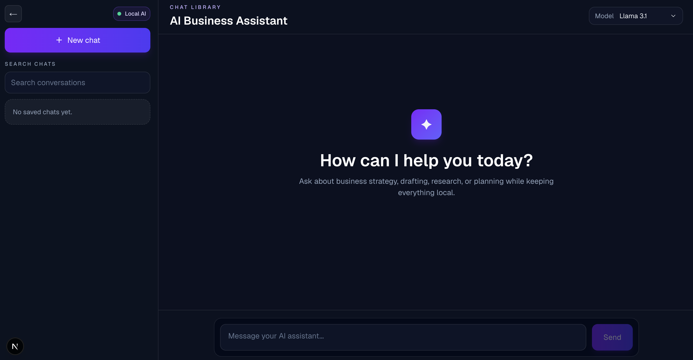

# AI Business Assistant

A locally hosted AI chatbot built with **Next.js, React, FastAPI, Python, and Ollama**. Run AI models on your own computer through a modern web interface.

## Features

- Chat with locally installed AI models
- Switch between supported Ollama models
- Save conversations and chat history
- Create, browse, rename and delete conversations
- Search existing conversations
- Modern web interface powered by Next.js
- Local FastAPI backend with SQLite storage
- REST API for chat, models and conversations
- Optional experimental media catalog module

## Application Screenshot



*Screenshot of the locally running AI Business Assistant.*

## Technology Stack

| Component | Technology |
|---|---|
| Frontend | Next.js 16, React 19, TypeScript |
| Styling | Tailwind CSS 4 |
| Backend | Python, FastAPI |
| AI Runtime | Ollama |
| Database | SQLite |
| API Communication | HTTP / JSON |

## Supported AI Models

The application supports a configurable selection of Ollama models, including:

- Mistral 7B
- Llama 3.1
- Dolphin Mistral 7B

Additional installed Ollama models can be registered in the backend's `SUPPORTED_MODELS` configuration.

## Requirements

- macOS, Linux or Windows with a compatible development environment
- Python and pip
- Node.js and npm
- Ollama installed and running
- Sufficient RAM for your selected AI model

## Installation

### 1. Clone the repository

```bash
git clone https://github.com/YOUR-USERNAME/ai-business-assistant.git
cd ai-business-assistant
```

Replace `YOUR-USERNAME` with your actual GitHub username once the repository is created.

### 2. Install Ollama

Download Ollama from https://ollama.com.

Pull a supported AI model:

```bash
ollama pull mistral
ollama pull llama3.1
ollama pull dolphin-mistral:7b
```

Make sure the Ollama service is running.

### 3. Start the FastAPI backend

```bash
cd backend
python3 -m venv .venv
source .venv/bin/activate
python -m pip install fastapi uvicorn requests pydantic
python -m uvicorn main:app --host 127.0.0.1 --port 8003
```

The application API will be accessible at:

`http://127.0.0.1:8003`

### 4. Start the Next.js frontend

Open a separate terminal:

```bash
cd frontend
npm install
npm run dev
```

Ensure the frontend API routes point to your FastAPI backend port.

Open the application at:

http://localhost:3000

## How to Use

1. Open the AI Business Assistant web interface.
2. Select an available Ollama model.
3. Enter your question in the chat interface.
4. Receive a response generated by your local model.
5. Access previously saved conversations from the conversation history.

## Project Structure

```text
ai-business-assistant/
├── backend/
│   ├── main.py
│   ├── adult_links.py
│   └── media_catalog.json
├── frontend/
│   ├── app/
│   │   ├── api/
│   │   ├── page.tsx
│   │   └── globals.css
│   └── package.json
├── screenshots/
│   └── chatbot.png
├── .gitignore
└── README.md
```

## Security and Privacy

The project runs AI inference locally through Ollama.

- Keep API credentials and private configuration out of version control.
- Do not commit SQLite chat databases containing user conversations.
- Restrict development APIs to localhost.
- The optional media catalog requires proper content authorisation and age assurance for public deployment.
- Local development test settings are not intended for production use.

## Project Status

Local development prototype. Additional testing, security hardening and production configuration are required before public deployment.

## License

A project licence has not yet been selected. Third-party models and dependencies retain their respective licence terms.
